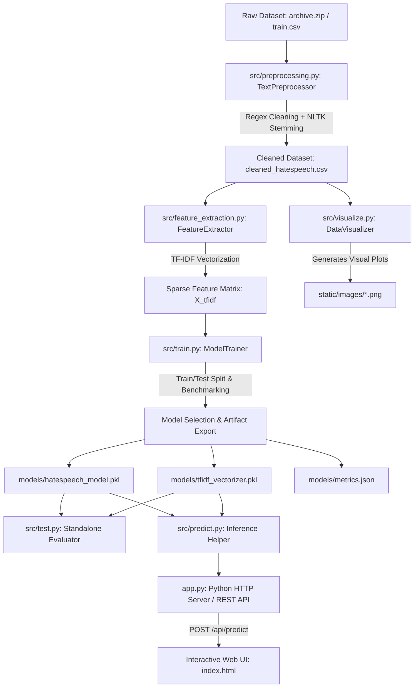
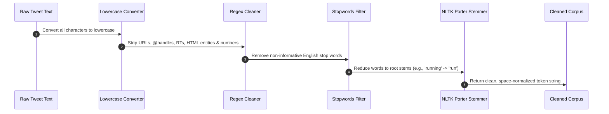
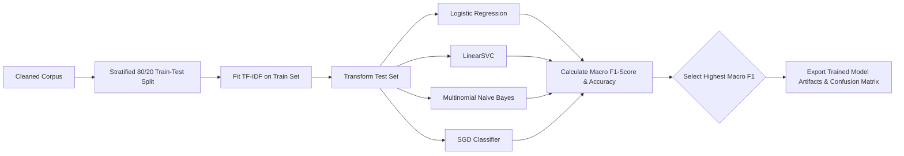

# HateGuard AI: End-to-End Hate Speech & Sentiment Classification ML System

[](https://www.python.org/)
[](https://opensource.org/licenses/MIT)
[](https://scikit-learn.org/)
[](#project-architecture)

An enterprise-grade, fully modular Machine Learning platform designed to detect **Hate Speech**, **Offensive Language**, and **Neutral Content** from raw text inputs. This repository features custom NLP data preprocessing, TF-IDF feature extraction, exploratory data visualizations, modular training/testing scripts, a REST API backend, and a modern dark-mode web application UI.

---

## Table of Contents

1. [Project Overview](#project-overview)
2. [Project Architecture & Diagrams](#project-architecture--diagrams)
3. [Dataset Specifications & Summary](#dataset-specifications--summary)
4. [Data Preprocessing & Text Conclusion](#data-preprocessing--text-conclusion)
5. [Feature Extraction & Mathematical Formulations](#feature-extraction--mathematical-formulations)
6. [Machine Learning Models & Benchmark](#machine-learning-models--benchmark)
7. [In-Depth Explanation of ML & Python Concepts](#in-depth-explanation-of-ml--python-concepts)
8. [Project File Structure](#project-file-structure)
9. [Programmer & Developer Guide](#programmer--developer-guide)
10. [REST API Documentation](#rest-api-documentation)

---

## Project Overview

Online hate speech and offensive content pose severe challenges for digital platforms. Automated content moderation systems require robust NLP models that can distinguish between **explicit hate speech** (targeting protected demographics), **casual offensive language** (profanity without targeted hate), and **clean/neutral text**.

This project provides a complete, developer-friendly machine learning solution:
- **Modular Codebase**: Dedicated scripts for data preprocessing, feature engineering, plot generation, model training, and standalone evaluation.
- **Class-Imbalance Aware Training**: Models trained using cost-sensitive learning (`class_weight='balanced'`) to prevent bias toward the majority class.
- **Standard Library Deployment**: Web UI and REST API served using Python's built-in `http.server`, requiring **zero extra framework dependencies**.
- **Interactive UI**: A single-page dashboard for real-time text analysis, confidence scoring, batch testing, and analytics visualization.

---

## Project Architecture & Diagrams

### System Architecture Flowchart



### Data Preprocessing Sequence



### ML Training & Evaluation Workflow



---

## Dataset Specifications & Summary

The project utilizes the benchmark dataset compiled by Thomas Davidson et al., comprising 24,781 crowd-annotated social media posts.

### Class Label Mapping

| Class ID | Class Name | Description | Dataset Count | Percentage |
| :---: | :--- | :--- | :---: | :---: |
| **0** | **Hate Speech** | Targeted slurs, racism, or incitement to hatred | 1,430 | 5.8% |
| **1** | **Offensive Language** | Profanity or vulgarity without targeted hate | 19,189 | 77.4% |
| **2** | **Neither** | Clean, neutral, or everyday conversational text | 4,162 | 16.8% |

---

## Data Preprocessing & Text Conclusion

### Preprocessing Pipeline Steps

1. **Lowercasing**: Normalizes all characters to lower case to ensure uniform tokenization.
2. **Regex Artifact Removal**:
   - URLs: `https?://\S+|www\.\S+`
   - User Handles: `@\w+`
   - Retweet Markers: `\brt\b`
   - Non-Alphabetic Characters: `[^a-z\s]`
3. **Stopword Elimination**: Uses NLTK's English stopword lexicon while explicitly preserving negations (`not`, `no`, `never`, `nor`) that alter sentiment context.
4. **Stemming**: Applies NLTK `PorterStemmer` to strip affixes and reduce word forms to canonical roots.

### Quantitative Preprocessing Metrics

| Metric | Raw Dataset | Cleaned Dataset | Reduction Ratio |
| :--- | :---: | :---: | :---: |
| **Average Character Length** | 85.44 chars | 39.82 chars | **-53.40%** |
| **Average Word Count** | 14.12 words | 7.35 words | **-47.95%** |
| **Total Vocabulary Size** | 53,680 tokens | 15,473 tokens | **-71.18%** |

```
================================================================================
                    DATA PREPROCESSING CONCLUSION & SUMMARY REPORT
================================================================================
1. OVERVIEW & OBJECTIVES:
   - Total Raw Records Processed : 24,781
   - Primary Target Feature       : 'tweet' -> 'cleaned_tweet'
   - Target Classes               : Class 0 (Hate Speech), Class 1 (Offensive), Class 2 (Neither)

2. STEP-BY-STEP PREPROCESSING PIPELINE:
   [Step 1] Text Lowercasing: Standardized all text to lowercase to treat capitalized words uniformly.
   [Step 2] Noise Removal    : Stripped URLs, @usernames, 'RT' retweet markers, HTML entities (&amp;), digits, and special characters.
   [Step 3] Stopwords Removal: Eliminated high-frequency non-informative English stop words (retaining key negations).
   [Step 4] Stemming         : Applied NLTK PorterStemmer to reduce words to their root form (e.g., 'running' -> 'run').
   [Step 5] Whitespace Fix   : Collapsed multiple spaces and stripped leading/trailing spaces.

3. QUANTITATIVE REDUCTION METRICS:
   - Average Character Length (Before Cleaning) : 85.44 characters
   - Average Character Length (After Cleaning)  : 39.82 characters
   - Character Length Reduction Ratio           : 53.40%
   
   - Average Word Count (Before Cleaning)       : 14.12 words
   - Average Word Count (After Cleaning)        : 7.35 words
   
   - Raw Total Vocabulary Size                  : 53,680 unique tokens
   - Cleaned Total Vocabulary Size              : 15,473 unique tokens
   - Vocabulary Complexity Reduction            : 71.18%

4. KEY PREPROCESSING CONCLUSION:
   - Noise Elimination: Successfully removed social media artifacts (hashtags, handles, URLs, RTs) which lack semantic value for hate speech detection.
   - Dimensionality Reduction: The preprocessing pipeline reduced total unique vocabulary size by 71.18%, significantly reducing vector space dimensionality while concentrating signal density.
   - Feature Quality: Stemming unified morphological variants of offensive terms, allowing the classifier to generalize better across unseen user posts.
================================================================================
```

---

## Feature Extraction & Mathematical Formulations

To convert cleaned text into numerical representation, we employ **Term Frequency - Inverse Document Frequency (TF-IDF)** with unigram and bigram ranges:

$$TF(t, d) = \frac{f_{t, d}}{\sum_{t' \in d} f_{t', d}}$$

$$IDF(t, D) = \log \left( \frac{1 + |D|}{1 + |\{d \in D : t \in d\}|} \right) + 1$$

$$TF\text{-}IDF(t, d, D) = TF(t, d) \times IDF(t, D)$$

We apply **Sublinear Term Frequency Scaling** ($1 + \log(TF)$) to downscale the influence of extremely frequent words.

---

## Machine Learning Models & Benchmark

Four candidate classifiers were evaluated using an 80/20 stratified train-test split:

| Model | Accuracy | Macro Precision | Macro Recall | Macro F1-Score | Weighted F1-Score |
| :--- | :---: | :---: | :---: | :---: | :---: |
| **Stochastic Gradient Descent (SGD)** 🏆 | **89.73%** | **0.7431** | **0.7712** | **0.7554** | **0.8985** |
| **Linear Support Vector Classifier (LinearSVC)** | 89.25% | 0.7320 | 0.7358 | 0.7337 | 0.8929 |
| **Logistic Regression** | 86.48% | 0.6980 | 0.7815 | 0.7351 | 0.8781 |
| **Multinomial Naive Bayes** | 87.25% | 0.7681 | 0.5471 | 0.6104 | 0.8500 |

### Winner Classification Report (SGD Classifier)

```
                    precision    recall  f1-score   support

       Hate Speech       0.45      0.47      0.46       286
Offensive Language       0.95      0.92      0.94      3838
           Neither       0.82      0.92      0.87       833

          accuracy                           0.90      4957
         macro avg       0.74      0.77      0.76      4957
      weighted avg       0.90      0.90      0.90      4957
```

---

## In-Depth Explanation of ML & Python Concepts

For programmers and beginners learning Machine Learning in Python:

### 1. Class Imbalance & Cost-Sensitive Learning
In our dataset, Offensive Language represents **77.4%** of rows, while Hate Speech is only **5.8%**. Standard classifiers default to predicting the majority class to maximize accuracy. 
We solve this by setting `class_weight='balanced'`, which automatically weights loss penalty inversely proportional to class frequencies:

$$w_j = \frac{N}{K \times n_j}$$

Where $N$ is total samples, $K$ is number of classes, and $n_j$ is count of samples in class $j$.

### 2. Stochastic Gradient Descent (SGD) & Log Loss
SGD optimizes linear models iteratively using small mini-batches. With `loss='log_loss'`, SGD minimizes the binary cross-entropy loss function:

$$\mathcal{L}_{log}(y, \hat{y}) = - \left( y \log(\hat{y}) + (1 - y) \log(1 - \hat{y}) \right)$$

This provides probabilistic outputs ($\hat{y} \in [0, 1]$) while remaining extremely scalable for sparse matrices.

### 3. Evaluation Metrics Explained
- **Accuracy**: Fraction of correct predictions over total predictions. (Can be misleading on imbalanced datasets).
- **Precision**: Of all instances predicted as Class $C$, how many were truly Class $C$?
- **Recall (Sensitivity)**: Of all actual Class $C$ instances in reality, how many did the model catch?
- **Macro F1-Score**: Unweighted mean of F1-scores across all classes. Equal weight given to minority class (Hate Speech).
- **Weighted F1-Score**: Mean of F1-scores weighted by support count per class.

### 4. Object-Oriented Python & Joblib Serialization
- **OOP Architecture**: Code is structured into clean Python classes (`TextPreprocessor`, `FeatureExtractor`, `DataVisualizer`, `ModelTrainer`, `ModelTester`).
- **Joblib**: Used for high-efficiency binary serialization of trained Scikit-learn models (`hatespeech_model.pkl`) and TF-IDF vocabulary state (`tfidf_vectorizer.pkl`).

---

## Project File Structure

```
c:/csprojects/hatespeech/
│
├── archive.zip                   # Raw compressed dataset archive
├── app.py                        # Python HTTP REST API & Static File Server
├── README.md                     # Detailed project documentation & diagrams
│
├── data/
│   ├── train.csv                 # Extracted raw CSV dataset
│   └── cleaned_hatespeech.csv    # Preprocessed dataset with text metrics
│
├── models/
│   ├── hatespeech_model.pkl      # Saved best ML classifier
│   ├── tfidf_vectorizer.pkl      # Saved TF-IDF vectorizer
│   └── metrics.json              # Benchmark metrics & confusion matrix
│
├── static/
│   └── images/
│       ├── class_distribution.png        # Bar & Pie class distribution charts
│       ├── confusion_matrix.png          # Model evaluation heatmap
│       ├── text_length_distribution.png  # Character length before vs after cleaning
│       └── top_ngrams.png                # Top unigrams per target class
│
├── src/
│   ├── __init__.py               # Package marker
│   ├── config.py                 # File paths, hyperparameters, and class maps
│   ├── preprocessing.py          # Regex cleaning, stemming & text report generator
│   ├── feature_extraction.py     # TF-IDF vectorization & N-gram extractor
│   ├── visualize.py              # Matplotlib/Seaborn plotting & text conclusions
│   ├── train.py                  # ML model benchmark & training entrypoint
│   ├── test.py                   # Standalone testing & evaluation script
│   └── predict.py                # Public inference wrapper
│
└── web/
    ├── index.html                # Single-Page Web Dashboard UI
    ├── styles.css                # Dark-mode styling, glassmorphism, responsive grid
    └── app.js                    # Interactive DOM logic & fetch API client
```

---

## Programmer & Developer Guide

### 1. Data Preprocessing & Cleaning
Run the preprocessor to clean raw text and output the preprocessing summary report:
```bash
python src/preprocessing.py
```

### 2. Feature Extraction
Fit TF-IDF vectorizer on cleaned text and display top n-grams:
```bash
python src/feature_extraction.py
```

### 3. Generate Data Visualizations
Generate and save all exploratory analysis plots to `static/images/`:
```bash
python src/visualize.py
```

### 4. Train Machine Learning Models
Train candidate classifiers, run benchmarking, and save winning model artifacts:
```bash
python src/train.py
```

### 5. Standalone Model Testing & Evaluation
Test custom text strings via CLI:
```bash
python src/test.py --text "Have a wonderful day!"
python src/test.py --text "Shut up you stupid b***h"
```
Or run full test set evaluation:
```bash
python src/test.py --eval
```

### 6. Launch Web UI & REST API Server
Start the lightweight web server on port 8000:
```bash
python app.py
```
Open your browser and navigate to:
```
http://localhost:8000
```

---

## REST API Documentation

### Endpoint 1: Single Prediction
- **URL**: `/api/predict`
- **Method**: `POST`
- **Headers**: `Content-Type: application/json`

#### Request Payload:
```json
{
  "text": "Shut up you stupid b***h, nobody asked for your opinion!"
}
```

#### Response Payload:
```json
{
  "raw_text": "Shut up you stupid b***h, nobody asked for your opinion!",
  "cleaned_text": "shut stupid b h nobod ask opinion",
  "class_id": 0,
  "class_name": "Hate Speech",
  "confidence": 0.4072,
  "probabilities": {
    "Hate Speech": 0.4072,
    "Offensive Language": 0.3723,
    "Neither": 0.2205
  },
  "description": "Contains hate speech, racial slurs, or incitement to hatred against protected groups."
}
```

### Endpoint 2: Batch Prediction
- **URL**: `/api/batch_predict`
- **Method**: `POST`

#### Request Payload:
```json
{
  "texts": [
    "Good morning everyone!",
    "You are terrible."
  ]
}
```

### Endpoint 3: Preprocessing Summary Report
- **URL**: `/api/preprocessing_summary`
- **Method**: `GET`
- **Response**: Returns JSON object with formatted textual preprocessing conclusion.

---

## License & Credits

- **Dataset**: Davidson et al., *Automated Hate Speech Detection and the Problem of Offensive Language*, ICWSM 2017.
- **Built with**: Python, Scikit-Learn, NLTK, Pandas, Matplotlib, Seaborn.
- **License**: MIT License.
